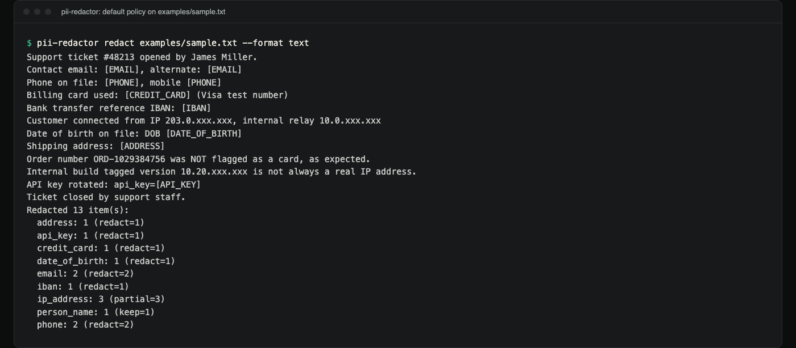
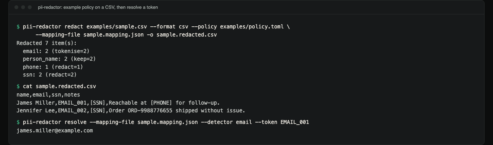
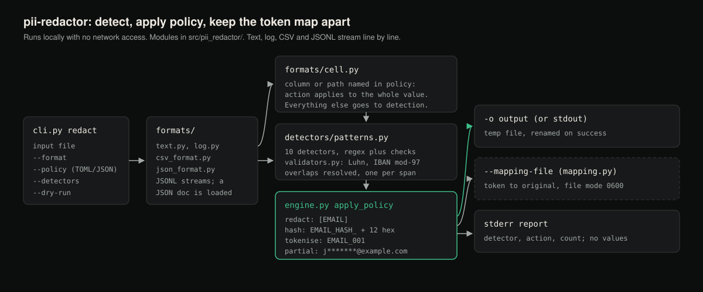

# pii-redactor

Detect and redact personal data (PII) in text, CSV, JSON/JSONL, and log
files under a per-detector policy, with an optional reversible token map kept
in a file separate from the redacted output.

**Status:** version 0.1.0, not published to PyPI; install from a clone. A
pattern-and-checksum tool with measured misses (see below), not a guarantee.
CI runs the tests on Linux, macOS and Windows with Python 3.10 to 3.13.

## Demo

Real terminal captures of the CLI on the synthetic files in `examples/`
(the same commands and output appear as text under [Examples](#examples)).



*Default policy on `examples/sample.txt`: markers for most detectors, partial masking for IPs, and a value-free report.*



*`examples/policy.toml` on `examples/sample.csv`: emails become reversible tokens, the `ssn` column is replaced whole, and `resolve` recovers a token from the mapping file.*

## What

`pii-redactor` scans a file for common categories of personal data (email
addresses, phone numbers, payment card numbers, IBANs, IP addresses,
national ID numbers, dates of birth, person names, postal addresses, and
API keys/tokens) and applies a configurable action to each match: redact
it, hash it, tokenise it (with a reversible mapping), partially mask it, or
explicitly keep it.

It runs entirely locally. Nothing is uploaded anywhere.

## Why

Sharing a production log, a support ticket export, or a CSV of customer
records with a vendor, a model provider, or a public bug tracker routinely
means leaking real customer data along with it. The two common ways people
deal with this are both unsatisfying:

- **Destroy the data** (blanket find/replace, or a cloud DLP tool set to
  maximum aggressiveness). You can no longer correlate records across the
  redacted export, count distinct users, or reproduce a bug tied to a
  specific account.
- **Use a cloud redaction service.** The data still leaves your machine; it
  just goes to the redaction vendor first.

`pii-redactor` is local-only and policy-driven: you decide, per detector
and per field, whether something gets destroyed (`redact`), pseudonymised
in a way that preserves joins (`hash`, `tokenise`), partially shown
(`partial`), or left alone (`keep`). Tokenisation keeps a reversible
mapping so an analyst with the mapping file (and only that analyst) can
still recover the original values later.

## Features

- Ten built-in detectors, several backed by real checksum validation
  (Luhn for cards, ISO 7064 mod-97 for IBAN) rather than pattern matching
  alone.
- Five policy actions per detector, per CSV column, or per JSON dotted
  path: `redact`, `hash`, `tokenise`, `partial`, `keep`.
- Reversible token map written to a **separate file**, never inline in the
  redacted output.
- Format-aware handling: plain text, line-structured logs, CSV (header +
  per-column policy), and JSON/JSONL (per dotted-path policy).
- Streaming line-by-line / row-by-row processing for text, log, CSV, and
  JSONL, so files far larger than available memory can be redacted.
- `--dry-run` reporting what *would* be redacted, by detector type and
  count, without writing any output or ever printing a detected
  value.

## Detectors reference

| Detector        | Method                                              | Confidence |
|------------------|------------------------------------------------------|------------|
| `email`          | RFC-shaped pattern match                              | high |
| `phone`          | Separator-aware pattern match, digit-count bounded    | medium/high |
| `credit_card`    | Digit-run candidate + **Luhn checksum**               | high |
| `iban`           | Pattern + **ISO 7064 mod-97-10 checksum** + length check per country | high |
| `ip_address`     | IPv4/IPv6 parsed with `ipaddress`; optional `keep_private_ips` to skip RFC 1918 / IPv6 unique-local (`fc00::/7`), loopback and link-local addresses (documentation, CGNAT and reserved ranges are still redacted) | high |
| `national_id`    | US SSN-shaped pattern with area/group/serial exclusions | high |
| `date_of_birth`  | Date pattern, only matched near a birth-context keyword (`DOB`, `born`, `date of birth`, `birth date`), plus a plausibility check (real calendar date, not in the future) | medium |
| `person_name`    | Two-token capitalised span where the first token is in a common-first-name dictionary | low |
| `address`        | Street-number + street-name + suffix pattern (optionally city/state/ZIP) | medium |
| `api_key`        | Known-vendor prefixes (AWS `AKIA`/`ASIA`, OpenAI `sk-`, GitHub classic (`ghp_`) and fine-grained PATs, Slack `xox*`, Google `AIza`, JWTs) plus a generic high-entropy-token heuristic | high/medium |

## Policies

A policy is a TOML or JSON file with three optional sections:

```toml
keep_private_ips = true
salt = "a-project-specific-salt-do-not-share"

[detectors]
email = "tokenise"
phone = "redact"
credit_card = "redact"
iban = "redact"
ip_address = "partial"
national_id = "redact"
date_of_birth = "redact"
person_name = "keep"
address = "redact"
api_key = "redact"

[csv_columns]
customer_email = "tokenise"
notes = "redact"

[json_paths]
"user.ssn" = "redact"
"user.email" = "tokenise"
```

- Detectors without an entry fall back to a sensible built-in default (see
  `pii_redactor.policy.DEFAULT_ACTIONS`).
- `csv_columns` and `json_paths` force an action on the **whole cell /
  whole field value** for that column or dotted path, regardless of
  whether a detector pattern matches. Use this for a column you know is
  always sensitive (e.g. `ssn`) even if its stored format varies. The
  override is labelled with the CSV column name, or the last segment of the
  JSON path: the `ssn` column becomes `[SSN]`, a tokenised `customer_email`
  column becomes `CUSTOMER_EMAIL_001` (resolve it with
  `--detector customer_email`), and the report counts it under that name.
- `salt` is used for the `hash` action. Use a project-specific salt; two
  files redacted with the same salt will hash the same input value to the
  same output. That is what makes joins across redacted files possible, and
  also why the salt itself must be kept as confidential as the data.

### Actions

| Action | Behaviour | Example |
|---|---|---|
| `redact` | Replace with a type marker | `[EMAIL]` |
| `hash` | Stable salted hash (joinable, not reversible without the salt) | `EMAIL_HASH_05c0763415f0` (12 hex chars) |
| `tokenise` | Sequential token, reversible via a **separate** mapping file | `EMAIL_001` |
| `partial` | Partially mask, keeping some structure (emails keep the first character and domain, cards the last four digits, IPv4 the first two octets) | `j*******@example.com`, `203.0.xxx.xxx` |
| `keep` | Leave the value untouched | (unchanged) |

## Architecture

Diagram of the data flow through the modules (a drawing, not a screenshot):



```
src/pii_redactor/
  detectors/       regex + checksum detectors, return Match(start, end, value, confidence)
  validators.py     Luhn and IBAN checksum implementations
  policy.py         Policy config model + loader (TOML/JSON)
  mapping.py        TokenMap: reversible token <-> value store, persisted separately
  engine.py         run_detectors + apply_policy -> (redacted_text, RedactionReport)
  formats/          per-format streaming adapters (text, log, csv, json/jsonl)
  cli.py            argparse CLI: `redact` and `resolve` subcommands
```

`RedactionReport` only ever stores detector names, action names, and
integer counts, never the detected values themselves (see Security,
below).

## Installation

Requires Python 3.10+. No runtime dependencies on 3.11+ (`tomli` on 3.10).

Not published to PyPI; install from a clone:

```bash
git clone https://github.com/hellpuffyt/pii-redactor && cd pii-redactor
python -m venv .venv
# macOS / Linux
.venv/bin/python -m pip install -e ".[dev]"
# Windows
.venv\Scripts\python.exe -m pip install -e ".[dev]"
```

The rest of this README writes `python` for the virtualenv's interpreter
(`.venv/bin/python` or `.venv\Scripts\python.exe`) and `pii-redactor` for
the console script installed next to it.

## Usage

```
pii-redactor redact INPUT --format {text,csv,json,jsonl,log}
                    [-o OUTPUT] [--policy POLICY] [--mapping-file MAPPING_FILE]
                    [--detectors DETECTORS] [--dry-run]
pii-redactor resolve --mapping-file MAPPING_FILE --detector DETECTOR --token TOKEN
```

Without `-o`, redacted output goes to stdout. The report always goes to
stderr. `--detectors` takes a comma-separated subset such as
`email,phone`; an unknown name is an error. If the policy uses `tokenise`
anywhere, `--mapping-file` is required (except with `--dry-run`).

Exit codes: `0` on success, `2` for usage and input errors (bad policy,
unknown detector, missing mapping file, unsafe paths, invalid UTF-8, JSON or
CSV), and `1` when `resolve` cannot find the token.

## Examples

`examples/sample.txt`, `examples/sample.csv`, and `examples/sample.jsonl`
contain synthetic data: invented names, `example.com` addresses, RFC 5737
and RFC 3849 documentation IP ranges, and the standard `4111111111111111`
Luhn-valid test card number. `examples/policy.toml` tokenises emails, keeps
private IPs and forces the `ssn` and `email` CSV columns. The CI smoke test
uses these files. All outputs below are from real runs.

Redact a text file with the default policy, to stdout:

```console
$ pii-redactor redact examples/sample.txt --format text
Support ticket #48213 opened by James Miller.
Contact email: [EMAIL], alternate: [EMAIL]
Phone on file: [PHONE], mobile [PHONE]
Billing card used: [CREDIT_CARD] (Visa test number)
Bank transfer reference IBAN: [IBAN]
Customer connected from IP 203.0.xxx.xxx, internal relay 10.0.xxx.xxx
Date of birth on file: DOB [DATE_OF_BIRTH]
Shipping address: [ADDRESS]
Order number ORD-1029384756 was NOT flagged as a card, as expected.
Internal build tagged version 10.20.xxx.xxx is not always a real IP address.
API key rotated: api_key=[API_KEY]
Ticket closed by support staff.
Redacted 13 item(s):
  address: 1 (redact=1)
  api_key: 1 (redact=1)
  credit_card: 1 (redact=1)
  date_of_birth: 1 (redact=1)
  email: 2 (redact=2)
  iban: 1 (redact=1)
  ip_address: 3 (partial=3)
  person_name: 1 (keep=1)
  phone: 2 (redact=2)
```

The redacted text goes to stdout and the report to stderr. The report counts every match, including those whose action is `keep`
(`person_name` is `keep` by default, so "James Miller" stays). Note that
`10.20.30.40` is a valid IPv4 address and is masked even though the sample
calls it a version string.

Redact a CSV with the example policy, tokenising emails into a separate
mapping file:

```console
$ pii-redactor redact examples/sample.csv --format csv --policy examples/policy.toml \
    --mapping-file sample.mapping.json -o sample.redacted.csv
Redacted 7 item(s):
  email: 2 (tokenise=2)
  person_name: 2 (keep=2)
  phone: 1 (redact=1)
  ssn: 2 (redact=2)
$ cat sample.redacted.csv
name,email,ssn,notes
James Miller,EMAIL_001,[SSN],Reachable at [PHONE] for follow-up.
Jennifer Lee,EMAIL_002,[SSN],Order ORD-9988776655 shipped without issue.
```

Recover an original value from a token with the mapping file:

```console
$ pii-redactor resolve --mapping-file sample.mapping.json --detector email --token EMAIL_001
james.miller@example.com
```

Redact JSONL (one JSON object per line). The example policy tokenises, so a
mapping file is needed here too:

```bash
pii-redactor redact examples/sample.jsonl --format jsonl --policy examples/policy.toml \
  --mapping-file events.mapping.json -o events.redacted.jsonl
```

The first output line is:

```json
{"user": {"name": "James Miller", "email": "EMAIL_001", "ssn": "[SSN]"}, "ip": "203.0.xxx.xxx", "note": "Card [CREDIT_CARD] charged successfully."}
```

### Dry-run output

`--dry-run` reads the whole input and writes only the report to stderr, with
detector names, action names, and counts. It never prints the values that
were found, writes no output file and does not create the mapping file:

```console
$ pii-redactor redact examples/sample.jsonl --format jsonl --policy examples/policy.toml --dry-run
Would redact 9 item(s):
  credit_card: 1 (redact=1)
  email: 2 (tokenise=2)
  ip_address: 2 (partial=2)
  person_name: 2 (keep=2)
  ssn: 2 (redact=2)
```

## Testing

```bash
python -m pytest
python -m ruff check .
python -m mypy
```

There are 171 tests. CI runs `pytest` on Ubuntu, macOS and Windows for Python
3.10 to 3.13, `ruff` and `mypy` on Linux, and a smoke job that redacts the
files in `examples/` with the CLI.

The test suite places particular emphasis on **false-positive guards**:
order numbers must not be flagged as credit cards, version strings must
not be flagged as IP addresses, and a capitalised sentence start must not
be flagged as a person name. Luhn and IBAN checksum validation is tested
in both directions (valid numbers accepted, invalid numbers rejected).

### Measured detection quality (synthetic corpus)

`tests/eval/corpus.py` is a hand-labelled corpus of **synthetic** data (110
lines: 72 containing 79 labelled PII values, plus 38 hard negatives such as
order numbers, dates, UUIDs, git SHAs, version strings and MAC addresses).
`python -m tests.eval.metrics` scores every detector against it; the result
below is copied from that command (all detectors enabled, private IPs not
skipped). A prediction counts as a true positive only with the right type
and the exact gold span; `leaked` is the number of gold values still present
verbatim after redacting with every detector set to `redact`.

| entity | support | TP | FP | FN | precision | recall | leaked |
|---|---:|---:|---:|---:|---:|---:|---:|
| email | 9 | 9 | 1 | 0 | 0.90 | 1.00 | 0 |
| phone | 9 | 8 | 5 | 1 | 0.62 | 0.89 | 1 |
| credit_card | 10 | 10 | 0 | 0 | 1.00 | 1.00 | 0 |
| iban | 10 | 10 | 0 | 0 | 1.00 | 1.00 | 0 |
| ip_address | 8 | 8 | 0 | 0 | 1.00 | 1.00 | 0 |
| national_id | 6 | 4 | 0 | 2 | 1.00 | 0.67 | 1 |
| date_of_birth | 5 | 4 | 0 | 1 | 1.00 | 0.80 | 1 |
| person_name | 6 | 5 | 2 | 1 | 0.71 | 0.83 | 1 |
| address | 7 | 7 | 1 | 0 | 0.88 | 1.00 | 0 |
| api_key | 9 | 9 | 1 | 0 | 0.90 | 1.00 | 0 |
| **all** | 79 | 74 | 10 | 5 | 0.88 | 0.94 | 4 |

**These numbers describe this small corpus only. They are not an estimate
of recall on your data and not a guarantee of anything.** The corpus was
written by the same people who wrote the detectors, so it is biased toward
formats the detectors know. The four values that leak are documented misses
(bare 10-digit phone number, SSN without separators, month-name date of
birth, a first name outside the dictionary); `tests/test_detection_eval.py`
fails if any other value leaks or if any error count rises.

## Security

- **This tool never prints or logs a detected value.** Dry-run reports and
  all diagnostic output contain only detector type, action, and count;
  error messages for malformed input give a line number or byte offset,
  never the offending content. `tests/test_cli_safety.py` checks this for
  every labelled value in the evaluation corpus, across all formats.
  A redaction tool that leaks what it found defeats its own purpose.
- The reversible token map is written to a file separate from the
  redacted output. **That mapping file is exactly as sensitive as the
  original, un-redacted data**: anyone with it can recover every
  tokenised value. Store it with the same access controls as the source
  data, never commit it to version control, and delete it once it is no
  longer needed. It is written with owner-only permissions (`0600`) on
  POSIX systems.
- The CLI refuses to run when `-o` is the input file, or when
  `--mapping-file` is the input or the output file (either would destroy
  data or put the original values where the redacted copy was expected).
  Output files are written to a temporary file and renamed into place, so a
  failed run never leaves a partial or overwritten output.
- An unknown name in `--detectors` or in a policy's `[detectors]` table is an
  error rather than being silently ignored.
- The `hash` action's salt is a secret in its own right: knowing the salt
  plus a guessable input space (e.g. all possible phone numbers) lets an
  attacker reconstruct a lookup table. Use a random, project-specific
  salt and keep it out of version control. If a policy uses `hash` without
  a `salt`, a built-in **public** default salt is used and the CLI prints a
  warning. Hashes are truncated to 12 hex characters (48 bits).

## Limitations

Be realistic about what this tool is:

- It is **pattern-and-validation-based detection, not a guarantee**. It
  will miss PII in formats it doesn't recognise (non-US national IDs
  beyond the SSN-style pattern, addresses outside the US street-suffix
  convention, phone numbers with unusual formatting) and it will
  occasionally over- or under-match on inherently ambiguous input.
- `person_name` detection is a low-confidence heuristic (dictionary +
  capitalisation) and is disabled (`keep`) by default because its false
  positive/negative rates are the highest of any detector here. Enable
  it deliberately and review its output.
- `date_of_birth` only fires near an explicit context keyword (`DOB`,
  `born`, `date of birth`, `birth date`) by design, to avoid flagging every date in a
  document; this trades recall for precision.
- JSON/JSONL **keys** are never scanned or redacted, only values. Numeric
  values are scanned in their decimal form (and replaced by a string when
  something is redacted); booleans and `null` are left alone.
- The CSV header row is passed through unchanged.
- Known measured misses and false positives are listed under "Measured
  detection quality" above (e.g. bare digit runs, SSNs without separators,
  month-name dates, `logo@2x.png` looking like an email, SSN-shaped
  reserved numbers being redacted as phone numbers).
- A single large JSON document (not JSONL) is loaded into memory as a
  whole, since JSON has no natural line-based streaming boundary. Text,
  log, CSV, and JSONL inputs stream line-by-line / row-by-row and are not
  bounded by available memory.
- This tool reduces risk; it does not eliminate it. Always review a
  sample of redacted output before sharing it externally, and treat this
  as one control among several (access controls, data minimisation,
  contractual terms), not a substitute for them.

## Contributing

See [CONTRIBUTING.md](CONTRIBUTING.md). Report vulnerabilities privately as
described in [SECURITY.md](SECURITY.md), not in a public issue.

## License

MIT © 2026 Prabesh Sharma. See [LICENSE](LICENSE).
